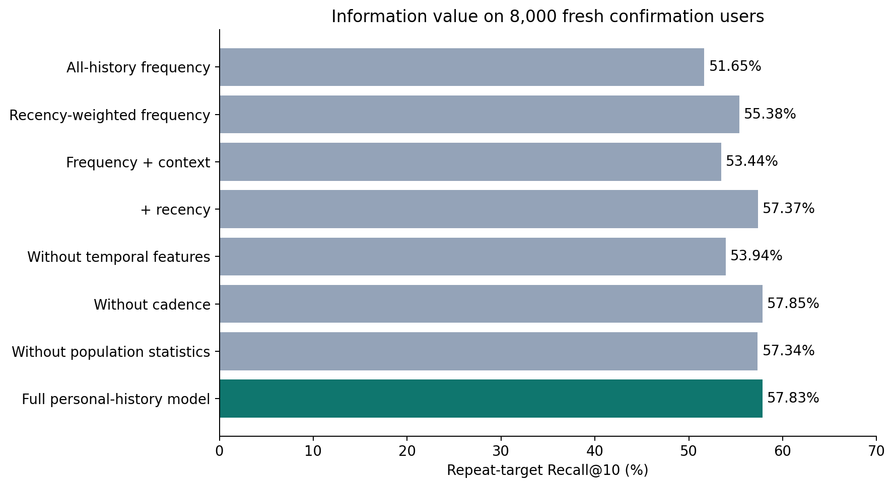
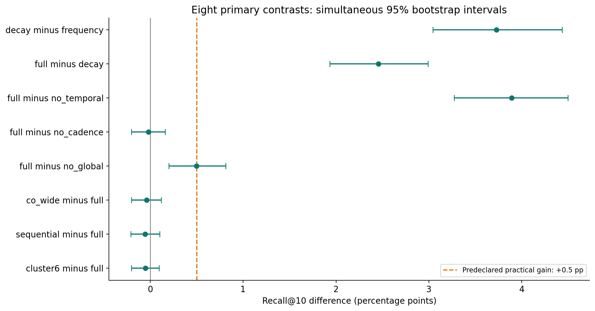
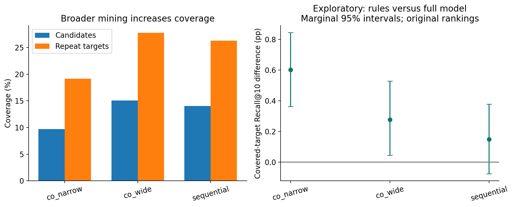
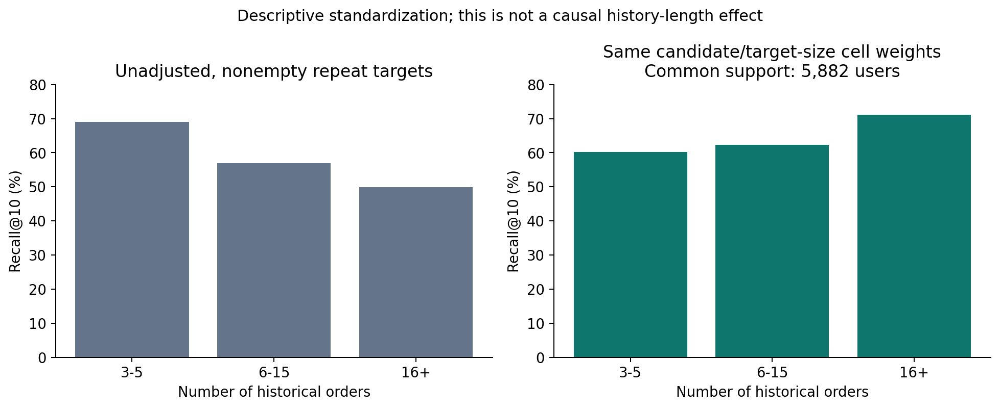

# Instacart 复购预测：哪些信息有用，复杂特征何时没有增益？

本文件是研究证据稿，供小组复核、讨论和自行撰写课程报告使用。全部数值来自本机真实运行，不是预设结果。

## 主要发现

1. **近期行为比累计频次更有预测价值。** 频次基线 Recall@10 为 51.65%，指数衰减频次为 55.38%，完整个人历史模型为 57.83%。移除全部时间相关特征后，完整模型的优势为 3.89 个百分点；支持超过预设 0.5 个百分点的正向收益。
2. **贡献可以拆开检验。** 购买节奏特征的条件增益为 -0.02 个百分点，未确认正向收益，且区间上界低于预设 0.5 个百分点；全局商品统计的条件增益为 0.50 个百分点，支持正向收益，但尚不能确认超过预设 0.5 个百分点。这是固定模型与其他特征后的消融，不能解释为因果影响或各组信息的绝对价值。
3. **本次规则和聚类没有有实际意义的总体增益，但规则存在局部信号。** 更宽共购规则、跨订单规则、验证集选定的聚类，三组相对完整模型的差值分别为 -0.04, -0.06, -0.05 个百分点；调整区间的上界均小于预设 +0.5 个百分点。窄共购规则在覆盖目标上的 Recall@10 提升约 0.60 个百分点，但总体没有收益。不能据此说所有规则无用，也不能把局部提升当成整体进步。
4. **“历史越长，模型越差”的直接解释不成立。** 原始短历史组 69.10%、长历史组 49.94%；限制共同支持并统一候选数、复购目标数的区间权重后，短组 60.15%、长组 71.20%，排序反转。对比改变了目标总体，分箱也较粗；这揭示了总体比较的混杂，不能证明增加历史会提高多少表现。

## 设计与问题边界

新研究排除第一轮全部 10,000 名用户，再固定抽取 33,000 名：20,000 训练、5,000 验证、8,000 最终确认。第一轮用于提出问题，不再作为独立验证。新划分种子为 20261109；每个学习模型用 42、73、123 三个训练种子，所有消融共享参数；确定性基线只运行一次。

主要目标是**下一单中历史买过商品的排序**。候选包含每位用户全部历史商品，无负采样。每用户最后一单作目标，其前全部订单作为历史；训练、验证、确认用户互不重叠。全局统计、分群、规则仅拟合训练用户历史，确认用户自己的过去记录可作为输入。下一单日期与间隔不作为特征。该数据没有绝对日期，因此并非全平台日历回测。

确认组有 8,000 名用户，其中 514 人没有复购目标。主指标对非空复购目标用户求平均；Precision/F1 包含所有用户。表中学习模型是三个种子的指标均值，**不是分数集成模型**。同分用商品 ID 排序，候选不足 10 时输出全部。

候选范围对整张下一单的平均覆盖上限为 59.97%；完整模型的整篮 Recall@10 为 35.11%，与复购 Recall@10 的 57.83% 分母不同。不能把后者称为整个购物篮的“准确率”。

## 实验结果

验证集选定 `co_wide`，聚类备选选定 `cluster6`，窗口基线选定 `window10`。选择在读取确认标签前固定；确认集没有用于重选模型。三种种子只反映这些训练随机性，未重复抽样训练用户。

| name | validation_recall | recall_at_10 | ndcg_at_10 | precision_at_10 | f1_at_10 | seed_recall_min | seed_recall_max |
|---|---|---|---|---|---|---|---|
| frequency | 0.5147 | 0.5165 | 0.4953 | 0.2748 | 0.3055 | 0.5165 | 0.5165 |
| decay | 0.5530 | 0.5538 | 0.5343 | 0.2985 | 0.3306 | 0.5538 | 0.5538 |
| window3 | 0.5004 | 0.5029 | 0.4803 | 0.2684 | 0.2977 | 0.5029 | 0.5029 |
| window5 | 0.5210 | 0.5215 | 0.5040 | 0.2814 | 0.3112 | 0.5215 | 0.5215 |
| window10 | 0.5292 | 0.5275 | 0.5092 | 0.2843 | 0.3146 | 0.5275 | 0.5275 |
| frequency_context | 0.5339 | 0.5344 | 0.5100 | 0.2809 | 0.3135 | 0.5341 | 0.5349 |
| frequency_recency | 0.5711 | 0.5737 | 0.5513 | 0.3064 | 0.3403 | 0.5734 | 0.5739 |
| no_temporal | 0.5383 | 0.5394 | 0.5147 | 0.2833 | 0.3162 | 0.5387 | 0.5402 |
| no_cadence | 0.5733 | 0.5785 | 0.5552 | 0.3083 | 0.3427 | 0.5783 | 0.5788 |
| no_global | 0.5728 | 0.5734 | 0.5520 | 0.3067 | 0.3405 | 0.5721 | 0.5744 |
| full | 0.5738 | 0.5783 | 0.5557 | 0.3086 | 0.3428 | 0.5771 | 0.5792 |
| co_narrow | 0.5732 | 0.5776 | 0.5552 | 0.3081 | 0.3424 | 0.5773 | 0.5780 |
| co_wide | 0.5744 | 0.5779 | 0.5558 | 0.3085 | 0.3428 | 0.5774 | 0.5789 |
| sequential | 0.5740 | 0.5778 | 0.5551 | 0.3083 | 0.3425 | 0.5774 | 0.5784 |
| cluster3 | 0.5731 | 0.5787 | 0.5557 | 0.3086 | 0.3429 | 0.5778 | 0.5792 |
| cluster6 | 0.5742 | 0.5778 | 0.5553 | 0.3083 | 0.3426 | 0.5771 | 0.5783 |
| cluster10 | 0.5739 | 0.5774 | 0.5550 | 0.3082 | 0.3423 | 0.5763 | 0.5782 |

## 主要对比及不确定性

事先声明 8 组主要对比、实际意义阈值 +0.5 个百分点。按用户配对 bootstrap 6,000 次，在用户层先平均三种种子的指标。下表同时给出边际 95% 区间与对 8 个比较进行 Bonferroni 调整的近似同时 95% 区间。区间条件于本次训练样本和三个已拟合模型，不包含重新抽样训练用户的不确定性。所有差值均以百分点表示。

| left | right | delta_pp | ci95_low_pp | ci95_high_pp | sim_low_pp | sim_high_pp |
|---|---|---|---|---|---|---|
| decay | frequency | 3.726 | 3.224 | 4.232 | 3.043 | 4.434 |
| full | decay | 2.456 | 2.078 | 2.840 | 1.933 | 2.992 |
| full | no_temporal | 3.890 | 3.455 | 4.326 | 3.272 | 4.495 |
| full | no_cadence | -0.018 | -0.147 | 0.113 | -0.203 | 0.160 |
| full | no_global | 0.498 | 0.280 | 0.731 | 0.202 | 0.814 |
| co_wide | full | -0.039 | -0.154 | 0.077 | -0.204 | 0.120 |
| sequential | full | -0.056 | -0.169 | 0.058 | -0.209 | 0.101 |
| cluster6 | full | -0.052 | -0.159 | 0.058 | -0.202 | 0.094 |

## 为什么关联规则未必有用？

窄规则在最常见 500 商品上挖掘；宽规则和跨订单规则扩大至 2,000 商品，同时降低支持度门槛并限制每个前件最多 50 条规则，因此这是**整套覆盖方案**的比较，不能把变化单独归因于商品数。跨订单规则只统计同一用户相邻订单，排除商品指向自身。长度为二的项集使用精确稀疏共现计数，已用人工小数据验证与 FP-Growth 一致。

规则由用户最后一张已观察订单触发。覆盖到目标后，仍从原完整候选排序中计算命中；不缩小候选池制造更高分。以下条件分析为探索性，使用边际区间；不能用它取代总体主要检验。

| rules | candidate_coverage | target_coverage_micro | users_any_covered_target | full_covered_recall | rule_covered_recall | delta | ci95_low | ci95_high |
|---|---|---|---|---|---|---|---|---|
| co_narrow | 0.0971 | 0.1913 | 3185 | 0.6404 | 0.6464 | 0.0060 | 0.0036 | 0.0084 |
| co_wide | 0.1508 | 0.2775 | 4572 | 0.6563 | 0.6591 | 0.0028 | 0.0004 | 0.0053 |
| sequential | 0.1402 | 0.2631 | 4447 | 0.6624 | 0.6639 | 0.0015 | -0.0008 | 0.0038 |

共购规则覆盖内确有局部信号：窄规则的条件差值区间不含零；宽规则的局部均值也为正，幅度较小；跨订单规则区间包含零。它们与总体无收益可以同时成立，因为覆盖内指标与总体指标的分母、参与用户不同。

为解释这个现象，在确认完成之后增加了**事后探索性分解**，没有再训练或重选模型。对同一批非空目标用户，把总 Recall 差值分为“规则覆盖目标的命中变化 / 全部复购目标数”和“未覆盖目标的命中变化 / 全部复购目标数”。两项恰好相加为总体变化，不能与上表覆盖内 Recall 差值直接相加。

| rules | covered_recommendations_per_user_delta | covered_delta | uncovered_delta | total_delta |
|---|---|---|---|---|
| co_narrow | 0.046000 | 0.000968 | -0.001704 | -0.000735 |
| co_wide | 0.024792 | 0.000560 | -0.000953 | -0.000392 |
| sequential | 0.025458 | 0.000271 | -0.000832 | -0.000561 |

窄共购规则将更多推荐名额给覆盖商品：覆盖部分贡献 +0.097 个百分点，未覆盖部分贡献 -0.170 个百分点，净值 -0.074 个百分点。这个算术分解表明，本次局部收益没有抵消其他目标命中的损失。宽规则的两部分区间仍含零，不应将其变化写成确定机制；全部区间见 `tables/rule_hit_decomposition.csv`。这是对冻结排序的描述，不是用户行为的因果实验，也不是提前指定的主要检验。

已有个人频次与近期特征可能吸收了部分规则信息，但本实验未直接测量信息冗余，不能把这个解释写成已证实机制。规则可作为展示关系的描述工具，不能冒充模型采用该建议的解释。

聚类轮廓系数范围 0.045–0.065，说明这些标准化画像下群体分离较弱；种子间 ARI 见 `tables/cluster_stability.csv`。较高 ARI 表示算法可重复，不能证明存在清晰的真实人群类别，也不能证明弱分离造成预测无增益。

## 历史长度与任务难度

| history_group | users | nonempty | recall | candidate_mean | candidate_median | target_mean | oracle_recall |
|---|---|---|---|---|---|---|---|
| 3-5 | 2304 | 2032 | 0.6910 | 27.1576 | 24.0000 | 4.3030 | 0.9721 |
| 6-15 | 3107 | 2912 | 0.5686 | 53.3212 | 48.0000 | 6.1967 | 0.9397 |
| 16+ | 2589 | 2542 | 0.4994 | 113.5319 | 102.0000 | 8.3132 | 0.8984 |

标准化使用候选数 × 复购目标数二维分箱，要求每个历史组每格至少 10 人，按共同支持总体格子频率赋相同权重。共有 11 格、5,882/7,486 名非空目标用户保留。其余用户被排除，因此标准化结果只适用于重叠人群。真实目标数只用于事后诊断，不进入推荐模型。

| history_group | standardized_recall | common_support_users | raw_common_support_recall |
|---|---|---|---|
| 3-5 | 0.6015 | 1992 | 0.6915 |
| 6-15 | 0.6235 | 2647 | 0.5914 |
| 16+ | 0.7120 | 1243 | 0.6238 |

额外在同一批历史至少 16 单用户上固定候选池与下一单目标，仅改变频次计数使用的最近订单窗口，避免不同用户构成干扰。以下为探索性比较，不能把截断计数窗口解释为用户只拥有那么多历史，也不能由此声称“删掉旧数据必然更好”。

| model | users | delta | ci95_low | ci95_high |
|---|---|---|---|---|
| window3 | 2542 | -0.0102 | -0.0210 | 0.0000 |
| window5 | 2542 | 0.0191 | 0.0093 | 0.0286 |
| window10 | 2542 | 0.0323 | 0.0246 | 0.0402 |
| decay | 2542 | 0.0541 | 0.0453 | 0.0628 |

K=5/20 的敏感性结果保存在 `tables/k_sensitivity.csv`。它们是预先声明的辅助指标，不用于重选模型。

同用户窗口实验提示：最近三单计数没有优于累计频次，而衰减加权有稳定优势；给旧信息逐渐降低权重，比笼统地“只留最新几单”更有依据。这里的周期消融只涉及已实现的订单间隔、间隔波动与间隔比例，不代表真实补货周期不重要；下一次购物的时间本身在当前预测时点未知。

## 对项目与产品的含义

项目的中心贡献是**增量信息与评估边界的实证分析**，不以刷新排行榜或发明新算法为贡献。建议标题为“个人近期行为与群体关联：下一单复购预测中的信息增益及边界”。已有研究已经强调复购与探索的区分，本项目应定位为课程级复现、消融与边界检查，而非首次发现该现象。[Li et al., A Next Basket Recommendation Reality Check](https://arxiv.org/abs/2109.14233)

实现可用于“可能再次购买”的短清单。它不能判断用户忘买了什么，不能替代新品推荐，没有实验表明能提高销售或节省购物时间。若将来做整篮推荐，需要增加新商品候选生成与独立评价，而非仅提高复购排序分数。

## 复核、复现与局限

独立审核 `PASS`：核对 78 个冻结文件与 6 个原始文件；直接从原始 CSV 重建确认组的 522,174 个候选和 85,002 个目标记录；以独立集合运算核对排序和 Recall、Precision、F1、NDCG。原始数据未修改。详见 `audit.json`。

完整步骤见根目录 README。`research/protocol.json` 是确认前方案，`autoresearch/research-v2/freeze.json` 保存模型、选择和输入哈希，逐种子模型与分数保存在运行目录中。主要结果表与图在本报告目录下。

局限包括：单个历史平台与有标签用户子样本；单一训练用户划分；只预测复购；固定长度清单；商品价格和绝对时间缺失；规则参数与表示覆盖范围有限；没有在线用户实验。多个种子不能替代跨数据集或跨时期复现。统计上很小的收益不自动等于产品收益。

课程要求的完整流程、比较、消融、讨论与演示均有可核查材料。课程 PDF 是示范与要求来源，不能从示范推断必须堆叠每一种算法。小组仍需根据正式 rubric 核对格式、页数、署名和引用，自己理解并完成最终报告、海报与答辩。

研究方案、实现、图表及本证据稿由 Codex 辅助生成，并实际运行验证；应如实披露 AIGC 用途，不将本稿直接作为独立完成的最终提交材料。数据下载来源为 [Kaggle 镜像](https://www.kaggle.com/datasets/yasserh/instacart-online-grocery-basket-analysis-dataset)，文件指纹保存在缓存清单中；仅凭 CSV 不能识别镜像页面的发布修订号。
