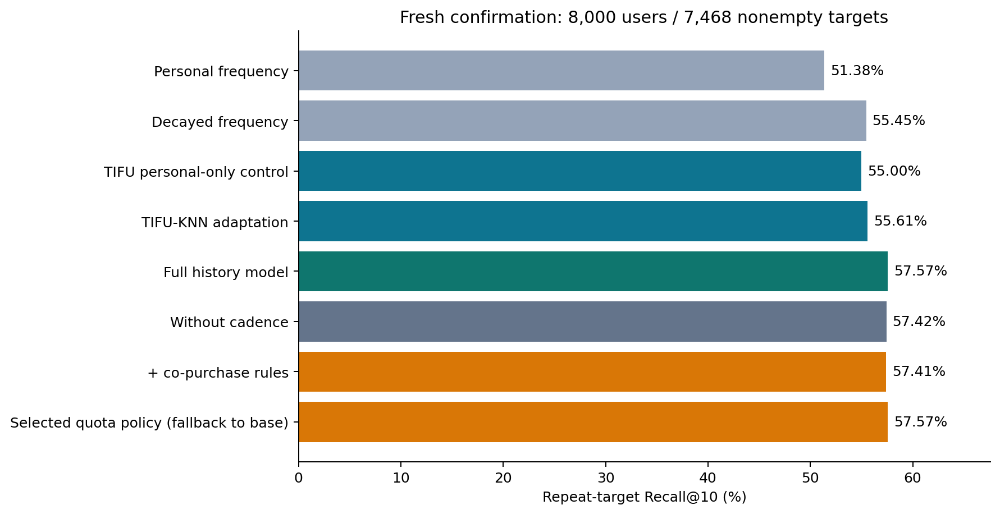
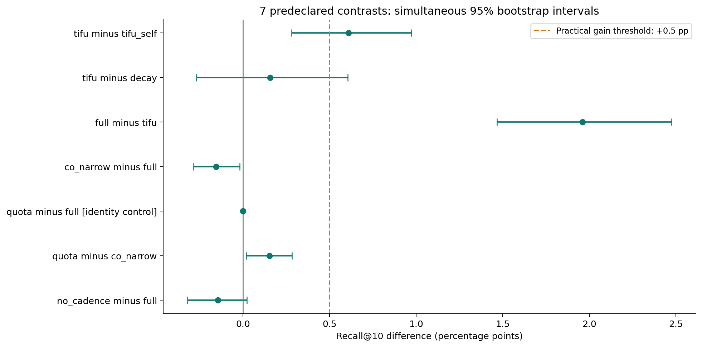
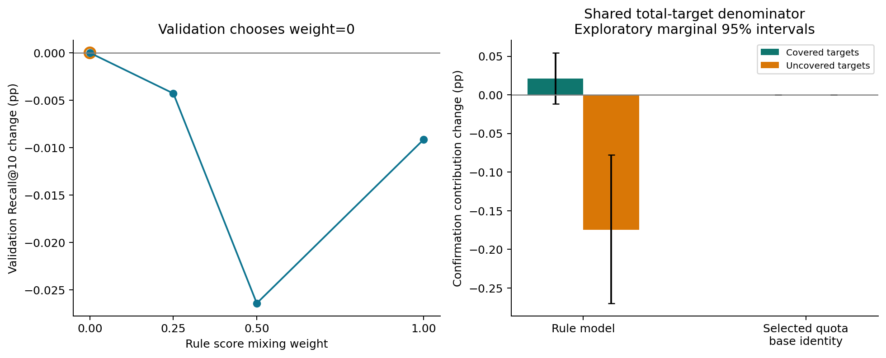
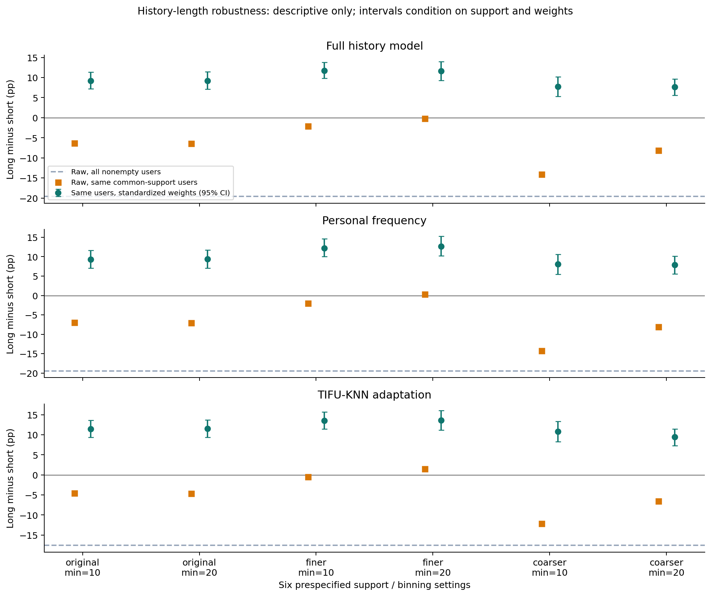

# 研究扩展：领域基线、配额约束与用户分组评价的稳健性

本文件是课程项目的研究证据稿，供小组复核与独立撰写最终材料。记录真实运行结果，包括没有带来改进的设计；不作为可直接提交的最终课程报告。

## 本轮完成了什么

在先前两轮的 43,000 名用户之外，重新抽取 33,000 名用户，分成 20,000 训练、5,000 验证、8,000 最终确认。训练样本和确认样本均是新用户。方法和参数在打开确认标签前固定；原研究不被覆盖。

本轮有三个明确产出：补入 TIFU-KNN 领域代表基线及同设置个人向量对照；把“覆盖商品占用推荐名额”的解释转为可执行的配额约束；用六套固定分箱规格、三种不同方法复查历史长度比较。共报告 8 种最终方法，学习模型的指标先在用户内平均 3 个训练种子；这不是分数集成。启发式与 TIFU-KNN 是确定性计算，单次运行。

1. **领域基线比较**：TIFU-KNN 适配版的确认 Recall@10 为 55.61%，完整历史模型为 57.57%。full − tifu 为 +1.960 个百分点，调整后的区间支持超过预设实际意义阈值的正向收益。加入邻居相对同一时间设置的个人向量对照，差值为 +0.609 个百分点，调整后的区间支持正向收益，但尚不能确认超过预设实际意义阈值。这检验了当前邻居实现，而不是所有群体信息的价值。因此先前的聚类/规则结果不能扩大解释为所有群体信息都没有用。
2. **提出并检验可解释的改进设计**：配额方案在验证集选择 w=0。验证集选中了 **w=0**，即保持原基础模型排序。四个候选权重里，非零权重没有取得更高的验证集平均 Recall。因此本轮没有采用非零规则重排；最终确认集 quota 与 full 的零差值是**定义上的恒等结果**，不能把它解释为独立证据，证明所有非零配额约束都没有价值。quota 相对普通规则模型的差值，此时就是基础模型相对普通规则模型的差值，不能归功于配额机制。本次有证据支持的结论是：所测试的约束与混合权重未在开发阶段赢得模型变更；停止调参并保留这个结果。
3. **加强评价发现并收窄未复现的解释**：三种方法的六套规格均得到正向标准化长组−短组差值，边际区间下界均为正，复现了对总体分组比较需要谨慎解释的发现。同时，关联规则覆盖内的改善必须重新检查，而不是沿用上一轮的解释。新确认数据中，窄规则覆盖目标的条件 Recall 差值为 +0.157 个百分点，边际 95% 区间为 [-0.093, +0.399] 个百分点。旧 V2 的对应探索性差值为 +0.602 个百分点，边际区间为 [+0.363, +0.844]。**新样本没有复现旧样本中同样明确的局部正向证据**，所以当前不能继续把“关联规则局部有效”作为无条件主结论。这不等于证明两轮真实效应存在统计差异；它要求收窄旧发现的适用范围。

## 可主张的贡献及其边界

这是一项课程级实证扩展：从已观察的局部/总体差异提出一个可测试约束，再用预先规定的开发选择和新用户确认评估；同时交付一个可复用的评价诊断，区分人群筛选与重新加权造成的变化。**提出并检验设计不等于已经获得有效的新方法**。配额和重排的思想不宣称全球首次；未证明用户购买行为的因果机制，也未声称达到领域最佳结果。

单纯增加模型个数不是贡献。领域基线用于检查原结论是否仅由比较对象过弱造成；同支持诊断用于检查解释是否受人群构成影响；配额方案则使“推荐名额挤占”这一解释受到可以失败的检验。

## TIFU-KNN 的来源与公平适配

依据 Hu、He、Gao、Zhang 的 [SIGIR 2020 原论文](https://arxiv.org/abs/2006.00556) 与 [作者公开实现](https://github.com/HaojiHu/TIFUKNN/blob/master/TIFUKNN.py) 独立编写稀疏实现。方法把用户自己的时间衰减购买向量与欧氏距离最近邻的平均向量混合。只允许训练用户进入邻居库；验证、确认用户仅提供自己的历史，不能成为彼此的邻居。商品维度保留完整目录，最终排序仍限于每位用户历史买过的全部候选。

原论文描述和作者代码的分组/组内衰减存在差异。本轮显式采用 `author_code` 语义，并以独立密集循环与手算短历史检查等价性。具体差别、公式与参考来源见 [实现说明](tifu_sources.md)。这是**复购候选任务上的适配**，不能拿本地分数与论文整篮榜单直接比较。

验证集共检验 24 个组合：两种分组数、三种邻居数、四种个人权重；包含论文 Instacart 的 m=3、rb=0.9、rg=0.7、k=900、alpha=0.9 参数。选择结果是 m=7、rb=0.9、rg=0.7、邻居数 300、个人权重 0.5。tifu_self 使用**选定 TIFU 配置的同一时间向量**，用于隔离邻居的增量作用；它不是单独优化时间参数得到的最强个人基线。

加入邻居相对同一时间设置的个人向量对照，差值为 +0.609 个百分点，调整后的区间支持正向收益，但尚不能确认超过预设实际意义阈值。这检验了当前邻居实现，而不是所有群体信息的价值。

**两个增量比较的起点不同**：邻居增益相对于 TIFU 的个人向量基线，规则增益相对于已经较强的完整 LightGBM 历史模型。因此不能把收益差异完全归因于信息表示，更不能据此证明邻居表示优于关联规则。较稳妥的表述是：群体信息的增量价值需要同时说明使用方式和已有个人模型基线。本轮没有运行“完整模型 + TIFU 邻居特征”的匹配对照，不能声称邻居信息仍能进一步改善完整模型。

全部验证组合见 `tables/tifu_validation.csv`，没有根据确认结果重新选择参数。

## 主要结果与七组预定比较

确认组有 8,000 人，其中 7,468 人下一单有复购目标。Recall 与 NDCG 排除空复购目标用户；Precision 与 F1 包含所有人。候选少于 10 时返回全部候选；同分按商品 ID 排序。

| name | validation_recall | recall_at_10 | ndcg_at_10 | precision_at_10 | f1_at_10 |
|---|---|---|---|---|---|
| frequency | 0.5156 | 0.5138 | 0.4913 | 0.2730 | 0.3048 |
| decay | 0.5582 | 0.5545 | 0.5340 | 0.2976 | 0.3309 |
| full | 0.5754 | 0.5757 | 0.5518 | 0.3068 | 0.3421 |
| co_narrow | 0.5757 | 0.5741 | 0.5512 | 0.3064 | 0.3415 |
| no_cadence | 0.5753 | 0.5742 | 0.5509 | 0.3061 | 0.3412 |
| quota | 0.5754 | 0.5757 | 0.5518 | 0.3068 | 0.3421 |
| tifu | 0.5591 | 0.5561 | 0.5373 | 0.2988 | 0.3320 |
| tifu_self | 0.5537 | 0.5500 | 0.5313 | 0.2961 | 0.3287 |

主要比较在用户层进行配对 bootstrap 6,000 次，并给出边际 95% 与对 7 个比较作 Bonferroni 调整的近似同时 95% 区间。实际意义阈值提前设为 +0.5 个百分点。区间条件于已经拟合的模型；不覆盖重新抽取训练用户的不确定性。以下差值均以百分点表示。

| left | right | delta_pp | ci95_low_pp | ci95_high_pp | sim_low_pp | sim_high_pp |
|---|---|---|---|---|---|---|
| tifu | tifu_self | 0.609 | 0.360 | 0.859 | 0.281 | 0.973 |
| tifu | decay | 0.157 | -0.165 | 0.484 | -0.269 | 0.605 |
| full | tifu | 1.960 | 1.586 | 2.338 | 1.468 | 2.474 |
| co_narrow | full | -0.154 | -0.251 | -0.053 | -0.284 | -0.019 |
| quota | full | 0.000 | 0.000 | 0.000 | 0.000 | 0.000 |
| quota | co_narrow | 0.154 | 0.053 | 0.251 | 0.019 | 0.284 |
| no_cadence | full | -0.144 | -0.274 | -0.014 | -0.320 | 0.022 |

普通规则模型相对完整模型的差值为 -0.154 个百分点，调整后的区间支持负向差异，结果不利于左侧方法。移除本次实现的间隔与波动特征后，Recall 差值为 -0.144 个百分点，没有确认正向收益，且调整后的区间上界低于预设实际意义阈值。比较方向是 no_cadence − full；不能把其符号误写成添加周期特征的收益。这些结果仅适用于实现过的特征与模型；不得据此宣布所有关联或真实补货周期无用。

## 配额约束：把上一轮解释变成可以失败的设计

对每位用户，先数出基础模型 top-K 中被规则覆盖的商品数 q，再保持 q 个覆盖名额、K−q 个未覆盖名额。各组内部按 `(1−w) × 基础分数 + w × 规则模型分数` 排序。覆盖标记和 q 都只来自历史与模型输出，不读取下一单标签。每个 K 都重新计算配额，候选不足 K 时选出全部候选。

该约束保证的是**覆盖/未覆盖的名额计数**，没有保证命中数。它仍可能在同组内换错商品，也可能阻止本来有益的跨组调整。w=0 是明确的“不改变基础结果”对照。完整方法与限制见 [配额设计](quota_method.md)。

如果未来进一步研究非零权重，还应加入“相同混合权重、没有配额限制”的匹配对照，才能把混合分数的作用与配额约束的作用分开。本轮未增加这个对照，也不据现有比较作机制归因。

| weight | recall |
|---|---|
| 0.0000 | 0.5754 |
| 0.2500 | 0.5753 |
| 0.5000 | 0.5751 |
| 1.0000 | 0.5753 |

验证集选中了 **w=0**，即保持原基础模型排序。四个候选权重里，非零权重没有取得更高的验证集平均 Recall。因此本轮没有采用非零规则重排；最终确认集 quota 与 full 的零差值是**定义上的恒等结果**，不能把它解释为独立证据，证明所有非零配额约束都没有价值。quota 相对普通规则模型的差值，此时就是基础模型相对普通规则模型的差值，不能归功于配额机制。本次有证据支持的结论是：所测试的约束与混合权重未在开发阶段赢得模型变更；停止调参并保留这个结果。

确认集的贡献分解沿用统一分母：每用户的全部复购目标数。覆盖部分和未覆盖部分相加恰好等于总 Recall 差值；这与“只在覆盖目标上的 Recall”不是同一个指标。此分析是探索性诊断，不替代主要比较。

| name | covered_slots_delta | covered_contribution_delta_pp | uncovered_contribution_delta_pp | total_delta_pp |
|---|---|---|---|---|
| co_narrow | 0.0252 | 0.0212 | -0.1747 | -0.1535 |
| quota | 0.0000 | 0.0000 | 0.0000 | 0.0000 |

本次规则候选覆盖比例为 9.75%，复购目标覆盖比例为 19.31%。完整边际区间、覆盖内 Recall 和每用户推荐名额变化均在 `tables/rule_decomposition.csv`。用户行为的因果机制不能由这些固定预测的算术分解推出。

新确认数据中，窄规则覆盖目标的条件 Recall 差值为 +0.157 个百分点，边际 95% 区间为 [-0.093, +0.399] 个百分点。旧 V2 的对应探索性差值为 +0.602 个百分点，边际区间为 [+0.363, +0.844]。**新样本没有复现旧样本中同样明确的局部正向证据**，所以当前不能继续把“关联规则局部有效”作为无条件主结论。这不等于证明两轮真实效应存在统计差异；它要求收窄旧发现的适用范围。

## 历史长度：可重复的诊断，不是因果调整

三个方法使用各自已经冻结的预测：完整历史模型、个人频次、TIFU-KNN。每个方法都运行 original/finer/coarser 分箱与每格每组至少 10/20 人的六套规格；不选择其中效果最好的规格。不同方法的共同支持人群一致，因为是否保留只由历史长度、候选数和真实复购目标数决定，不由模型表现决定。

| 方法 | 有效规格 | 标准化差值最小_pp | 标准化差值最大_pp | 六规格CI下界均正 | 六规格同支持内均反转 | 保留用户最少 | 保留用户最多 |
|---|---|---|---|---|---|---|---|
| full | 6 | 7.684 | 11.738 | True | True | 4484 | 6595 |
| frequency | 6 | 7.886 | 12.662 | True | False | 4484 | 6595 |
| tifu | 6 | 9.414 | 13.634 | True | False | 4484 | 6595 |

- `full`：六套规格的区间下界均为正；六套规格都在相同支持人群内发生方向反转。
- `frequency`：六套规格的区间下界均为正；并非六套规格都在相同支持人群内反转，不能把全部变化归因于重新加权。
- `tifu`：六套规格的区间下界均为正；并非六套规格都在相同支持人群内反转，不能把全部变化归因于重新加权。

图中灰虚线是所有非空目标用户的原始长组−短组差值；橙色方点是限制到共同支持后的同一批用户原始差值；绿色点是在这批相同用户上重新分配格子权重后的差值。**灰到橙是人群筛选变化，橙到绿才是同样本人群的权重变化**。二者不能混为“控制了规模后的因果效应”。每个方法的逐组人数、保留比例、所有格子均值和权重均随报告保存。

历史诊断区间使用 1,000 次格内用户 bootstrap，固定观察到的共同支持、格子人数和总体权重。因此区间反映这些条件下的用户抽样波动，不包含选择支持、估计权重或再训练的波动；六套规格是敏感性分析，不应当作六次独立发现。

真实目标大小是未来结果，仅用于事后评价，不能进入预测模型；对它作条件化可能引入选择效应，粗分箱也不能消除格内差异。若结果依赖具体模型或某些规格，应将贡献写成“识别评价解释的边界”，而不能写成适用于所有方法的历史长度定律。

旧 V2 的六规格事后分析中，标准化差值为 10.32 至 14.82 个百分点；其输出另存 `tables/history_v2_full_exploratory/`。这是已经观察过的数据，不能算新的独立确认。旧研究更细分箱/min20 的同支持原始差值已经略为正，说明共同支持筛选本身也会改变人群比较，不能把所有方向变化只归因于加权。

## 整篮范围与辅助检查

完整模型的复购 Recall@10 为 57.57%，对整张下一单的 Recall@10 为 34.90%。全部历史候选对下一单的平均覆盖比例为 59.90%；新品不在候选中。这些分母不同，不能统称购物篮“准确率”。预先指定的 K=5、20 结果保存在 `tables/k_sensitivity.csv`，未用于重新选择模型。

独立审核 `PASS`：排除 43,000 名此前研究用户，旧新重叠为 0；从原始 CSV 重建 523,759 个确认候选和 84,566 条目标记录；审核 16 个预测配置的排序及四项逐用户指标。还检查训练专属邻居库，并对 24,000 个用户×种子比较验证名额守恒，发现 0 个不一致。详见 `audit.json`。

## 如何用于课程项目

推荐把主线组织为“假设—诊断—设计—验证”：先说明基础方法为何需要领域基线，再解释局部收益与总体收益的区别，提出配额约束并诚实报告验证选择，最后展示分组评价如何受人群构成影响。保留负结果能使推理链完整；不能把没有采用的非零重排描述成成功算法。

仍有限制：只有 Instacart 一个平台；领域基线适配的是复购子任务；训练/确认划分虽然更换但仍非跨时期回测；没有真实在线购物实验；方法网格有界，并未穷举全部邻居、规则或重排设计。新增实验提供课程级证据，不构成全领域的新颖性或最佳性能证明。

研究方案、实现与证据稿由 Codex 辅助生成并实际执行。小组应理解和复核方法，独立组织最终报告、海报和答辩，并按课程规定披露 AIGC 用途。研究数据不随报告对外发布。
