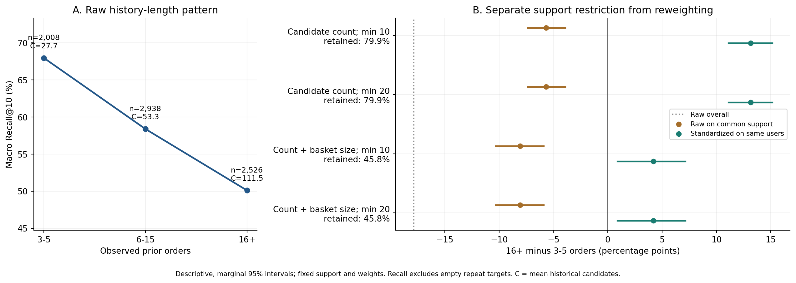
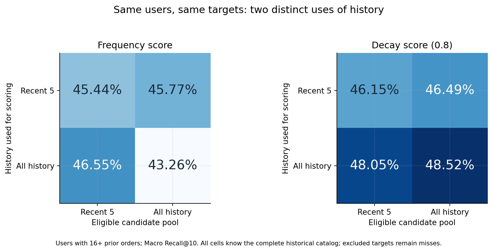
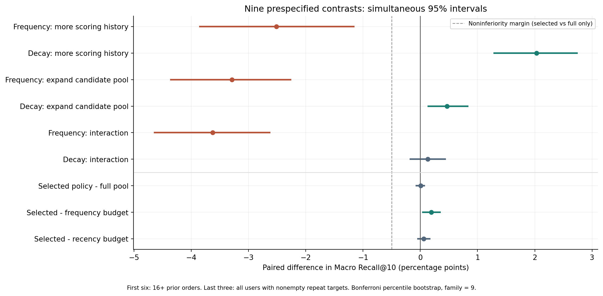
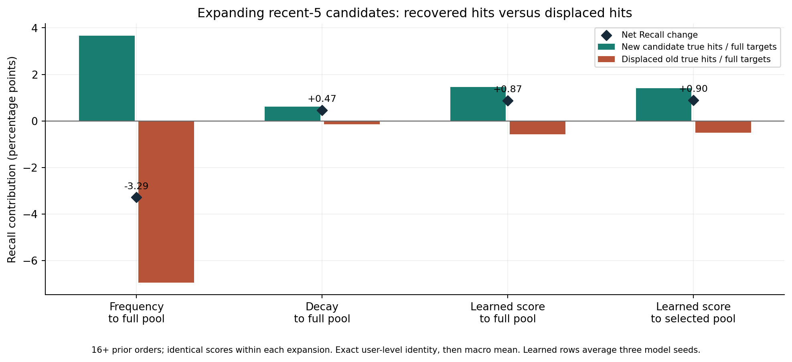
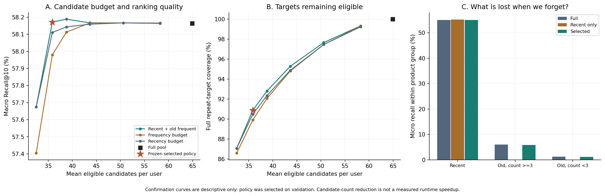

# 订单越多，下一单反而更难预测？购物推荐应该忘掉什么

本轮把原来的问题改写成一个可以被实验推翻的命题：**历史既用于给商品评分，也决定哪些商品有资格竞争前10名。两种作用必须分开检验。**

确认集里，16+ 单用户相对 3–5 单用户的原始 Recall@10 差为 -17.86 个百分点。“更多订单对应更难预测”的起点在本样本成立。 冻结方案“最近5单商品 + 最多 5 个历史高频旧商品”把平均候选数从 64.92 降至 35.85（减少 44.79%），独立确认满足预设 0.5 个百分点的 Recall@10 非劣界限。 选定方案相对完整候选的 Recall@10 差为 **+0.0072 个百分点**，九项主要对比的同时95%区间为 **[-0.0657, +0.0713]**。本轮主线落为：**区分评分信息和候选资格，检验怎样利用时间信息、怎样在明确损失边界内精简候选，并保留覆盖代价与反例。**

## 1. 任务和证据边界

使用 Instacart 已观察历史预测用户终末一单中再次购买的商品。训练、验证、确认用户各为 **20,000 / 5,000 / 8,000**；本轮排除此前实验已使用的用户。完整历史重复购买目标记为 R_full，任何候选删减都不改变 R_full、不删除用户，也不把被排除的真目标变成“无需预测”。没有目标的用户仍计数，但其 Recall/NDCG 不定义。

主要指标是用户平均 Recall@10，不是分类准确率。完整候选模型的重复购买 Recall 为 **58.16%**；按整篮全部商品作分母只有 **35.82%**。重复商品占整篮目标总数 **60.45%**，所以本项目不声称解决首次购买商品推荐。

学习模型沿用 LightGBM 的既有特征与训练设置，三个随机种子分别拟合。先对每名用户的指标取三个种子的均值，再做配对分析；**这不是预测分数集成**。验证集只选择旧商品保留数 M，随后冻结协议、数据与模型，再一次性打开新确认集。所有九项主要对比使用 6,000 次用户配对 bootstrap，并报告 Bonferroni 同时95%区间；不把多个种子当作独立用户扩增样本量。

独立审计 **PASS**：检查了 8,000 名确认用户的原始时序、标签、完整候选、冻结哈希、排名及指标。 追踪信息见 [provenance.json](provenance.json)、[协议](protocol.json)、[审计摘要](audit_summary.json)。报告重跑只更新展示文件，不重新训练或选择策略。

## 2. A：先检验“历史越多越难”的观察

| 历史订单数 | 全部用户 | 非空目标用户 | 平均历史候选数 | Recall@10 |
| --- | --- | --- | --- | --- |
| 3-5 | 2254 | 2008 | 27.66 | 67.97% |
| 6-15 | 3156 | 2938 | 53.34 | 58.39% |
| 16+ | 2590 | 2526 | 111.48 | 50.11% |

只使用预测时可见的历史候选数、历史平均篮子大小分层，分别要求每个历史组在每格至少10或20人，四种方案全部呈现。下表的差异均为“16+单 − 3–5单”，单位为百分点。

| 分层方案 | 保留用户 | 保留比例 | 全体原始差 | 同支持原始差 | 标准化差 | 标准化边际95%区间 |
| --- | --- | --- | --- | --- | --- | --- |
| Candidate count; min 10 | 5970 | 79.90% | -17.86 | -5.68 | +13.15 | [+11.10, +15.13] |
| Candidate count; min 20 | 5970 | 79.90% | -17.86 | -5.68 | +13.15 | [+11.10, +15.13] |
| Count + basket size; min 10 | 3424 | 45.82% | -17.86 | -8.06 | +4.21 | [+0.90, +7.15] |
| Count + basket size; min 20 | 3424 | 45.82% | -17.86 | -8.06 | +4.21 | [+0.90, +7.15] |

四种预设方案中，4 种有可比支持；标准化点差 4 种为正、0 种为负。四种方案均在同一共同支持样本内发生方向反转，说明原始组间差异对历史候选构成的权重敏感。 四种预设规格在本数据产生 **2 套不同的支持单元与权重**。同一分层方案的10/20人门槛没有改变支持，不能称为四次独立复制。 全体原始→同支持原始是**样本筛选变化**；同支持原始→标准化才是**同一保留人群上的重加权变化**。两部分不能混称为“控制变量解释了下降”。标准化区间是四种敏感性诊断的边际区间，条件于已选支持、固定权重和既有模型，不能冒充九项主要对比的同时区间。

分层没有使用下一单商品数，但 Recall 人群仍受“未来重复目标非空”的纳入条件限制。粗分箱残留差异、未观测因素以及历史变量本身可能随历史积累变化，因此 A 只能说明组间比较对构成的敏感性，不能证明多购物导致更难或更易预测。另存的未来目标大小条件化分析仅作回顾敏感性，不承担主线证据。

## 3. B：把“记住多少”拆成两个因素

对相同的长历史用户（≥16单），固定同一未来目标和完整历史目录，只改变：①评分读取最近5单还是全部历史；②允许最近5单商品还是全部历史商品竞争。两种评分分别是购买频次、0.8衰减频次。最近评分仍知道完整目录，只是窗口外购买记录不计入分数。

| 评分历史 | 候选池 | 频次 Recall@10 | 衰减 Recall@10 |
| --- | --- | --- | --- |
| 最近5单 | 最近5单 | 45.44% | 46.15% |
| 全部历史 | 最近5单 | 46.55% | 48.05% |
| 最近5单 | 全部历史 | 45.77% | 46.49% |
| 全部历史 | 全部历史 | 43.26% | 48.52% |

“增加评分历史”是在完整候选池上比较全历史评分与最近5单评分；“扩展候选池”是在完全相同的全历史分数上比较完整候选与最近5单候选；交互项为前一个评分历史差异在两种候选池下的差中之差。它们回答不同问题，不能把窗口效果全部解释为行为遗忘。

在完整候选池上，增加评分历史对频次的影响为 **-2.51** 个百分点，对衰减的影响为 **+2.03**；保持全历史分数固定后扩展候选，对频次的影响为 **-3.29**，对衰减为 **+0.47**。这四个方向均由同时区间确认：历史信息和旧商品并非天然有害，其作用取决于评分是否处理了购买时间。不能由频次模型的退化推出所有模型都应该忘掉旧历史。

交互项还有一个设计上的边界：最近5单评分给所有窗口外商品零分。只要近期候选不少于10个，增加这些零分旧商品就不会改变前10名；近期候选不足10个时才可能补入。因而交互并非完全出乎意料的现象，它部分反映旧记录让旧商品重新进入排名。主解释优先依赖**全历史分数固定时的候选扩展及精确记账**，以及学习模型的冻结方案与同预算对照。

| 主要对比 | 非空目标用户 | Recall差（百分点） | 同时95%区间 | 证据判断 |
| --- | --- | --- | --- | --- |
| 频次：增加评分历史 | 2526 | -2.51 | [-3.85, -1.16] | 负向差异已确认 |
| 衰减：增加评分历史 | 2526 | +2.03 | [+1.29, +2.73] | 正向差异已确认 |
| 频次：扩展候选池 | 2526 | -3.29 | [-4.36, -2.26] | 负向差异已确认 |
| 衰减：扩展候选池 | 2526 | +0.47 | [+0.14, +0.83] | 正向差异已确认 |
| 频次：两因素交互 | 2526 | -3.62 | [-4.64, -2.63] | 负向差异已确认 |
| 衰减：两因素交互 | 2526 | +0.13 | [-0.17, +0.44] | 区间跨零，方向未确认 |
| 选定策略 − 完整候选 | 7472 | +0.01 | [-0.07, +0.07] | 区间跨零，方向未确认；非劣通过 |
| 选定策略 − 同预算最高频 | 7472 | +0.19 | [+0.04, +0.34] | 正向差异已确认 |
| 选定策略 − 同预算最近购买 | 7472 | +0.06 | [-0.04, +0.17] | 区间跨零，方向未确认 |

扩展候选池可能找回旧商品，也可能让旧候选挤掉原来正确的推荐。逐用户核对的恒等式为：**新增候选带来的正确命中 − 被挤掉的原候选正确命中 = 总命中变化**。每一项除以同一个 R_full，再取用户均值，得到下表；单位为 Recall 百分点。它是离线排名的精确记账，不是关于消费者心理的因果分解。

| 最近5单候选扩展 | 找回真命中贡献 | 挤出真命中贡献 | 净变化 |
| --- | --- | --- | --- |
| 频次：最近→完整 | +3.66 | -6.94 | -3.29 |
| 衰减：最近→完整 | +0.61 | -0.14 | +0.47 |
| 学习模型：最近→完整 | +1.45 | -0.58 | +0.87 |
| 学习模型：最近→冻结方案 | +1.41 | -0.51 | +0.90 |

本轮把“增加评分历史”和“扩大候选竞争”分开后，即使其中一个对比为负、另一个为正，也不矛盾。负向结果与方向尚未确认的结果同样用于界定哪种记忆值得保留。

## 4. C：能否保留信息、适度压缩候选？

候选方案为最近5单商品并集最多 M 个旧商品，旧商品按历史频次、最近购买距离、商品ID稳定排序，全部在观察历史内完成。验证集考察 M=[0, 5, 10, 20, 40, 80]；先筛选相对完整候选的配对边际95%下限≥−0.005的方案，再选择平均候选数最少者；没有合格方案则回退完整候选。这个搜索仅是开发阶段选择，**不能当作确认结论**。

冻结方案为 **最近5单商品 + 最多 5 个历史高频旧商品**。确认阶段非劣判定必须用九项对比的同时区间下限≥−0.005；本轮结果是 **通过**。非劣只容许预设范围内的损失，不等于相等、不等于更好，也不等于完全不丢目标。

| 候选策略 | Recall@10 | NDCG@10 | 平均候选数 | 目标覆盖率 | 候选内Oracle Recall@10 |
| --- | --- | --- | --- | --- | --- |
| 完整历史候选 | 58.16% | 56.04% | 64.92 | 100.00% | 93.34% |
| 仅最近5单 | 57.67% | 55.82% | 32.49 | 87.06% | 82.73% |
| 冻结选择的策略 | 58.17% | 56.04% | 35.85 | 90.87% | 86.09% |
| 同预算：最高频 | 57.98% | 55.95% | 35.85 | 89.91% | 85.42% |
| 同预算：最近购买 | 58.11% | 56.02% | 35.85 | 90.48% | 85.73% |

同预算基线对每名用户严格使用与冻结方案相同的候选数量，分别选择历史最高频或最近购买商品，再用同一学习模型分数排名。两个同预算对比中，1 个通过同时区间确认正向差异；不能宣称对所有同预算选择都更优。

下面的商品分组仅用历史定义；“旧”指最近5单未买。目标占比和组内召回为按商品汇总的 micro 指标，与主要的用户平均 Recall 不同，不能直接混算。

| 历史商品组 | 目标占比 | 完整候选组内召回 | 仅最近组内召回 | 冻结方案组内召回 |
| --- | --- | --- | --- | --- |
| 最近5单买过 | 86.20% | 54.99% | 55.22% | 55.01% |
| 旧商品且累计购买≥3次 | 4.85% | 6.04% | 0.00% | 5.88% |
| 旧商品且累计购买<3次 | 8.94% | 1.25% | 0.00% | 1.18% |

覆盖率是全部重复目标中仍有资格被推荐的比例，再对用户平均；Oracle 还考虑最多只能返回10件。冻结方案只覆盖 **90.87%** 的完整重复目标，平均 **9.13%** 的目标在该策略下失去资格。即使Top10非劣成立也不代表目标覆盖无损；因为原模型本来未在前10名找回所有这些目标。低命中率也不能证明这些旧商品对用户不重要。删候选能减少竞争，却也制造不可恢复的漏召回。

本报告的 **44.79%** 减少按候选总量比计算，等于相同用户数下平均候选数的比；逐用户先求保留比例再平均则为 **73.01%**，两种汇总不可混用。候选数下降只是潜在计算量的代理：本轮保留完整历史特征，先计算完整候选分数再筛选，**没有证明真实评分加速、历史存储节省或相同百分比的端到端提速**。

敏感性结果：K=5 时冻结方案相对完整候选的 Recall 点差为 -0.0013 个百分点；K=20 时冻结方案相对完整候选的 Recall 点差为 -0.3075 个百分点。K=20 的点估计损失比主要 K=10 结果明显：完整候选 76.31%，冻结方案 76.00%。这是适用范围的反例，不能把 Top10 的非劣结论直接外推到更长列表；这里没有另作确认性区间检验。 窗口3/10的两因素结果、全部确认预算曲线和K敏感性均为已冻结方案之外的描述检查，不据此重新选择M或宣布新的主要胜利。

## 5. 可以答辩的贡献，以及明确的反例边界

1. **评估设计贡献**：把评分信息和候选资格拆开，固定用户、未来目标及 Recall 分母，避免通过删掉难预测目标制造收益。原始→同支持→标准化的三步同时防止把样本筛选误说成解释。
2. **机制证据贡献**：两种评分的2×2对照配合逐用户找回/挤出记账，说明“利用更多历史”和“让更多旧商品竞争”是可分离的算法操作。主要区间跨零或方向不一致时，结论必须相应收窄。
3. **可复现策略检验贡献**：把历史定义的双层候选方案与两个逐用户同预算基线放到新用户确认集，公开冻结过程、同时区间、覆盖损失及失败条件。冻结方案“最近5单商品 + 最多 5 个历史高频旧商品”把平均候选数从 64.92 降至 35.85（减少 44.79%），独立确认满足预设 0.5 个百分点的 Recall@10 非劣界限。

这些是课程项目层面的完整研究贡献，不宣称发明新推荐算法或达到最新最好水平。此前V2/V3仅提供提出本轮问题的探索背景，不能与新确认样本拼接扩充证据。

限制包括：单一数据集与离线终末订单任务；仅预测历史见过商品；历史长短是不同用户的观察比较；标准化仅在共同支持内有效；置信区间条件于已训练模型与支持，未包含重新采样训练全流程的不确定性；3/10窗口、K及商品组结果属于描述敏感性；完整目录在所有评分窗口中已知，不能推广为没有旧目录知识的冷启动。若非劣未通过，应明确保留失败结论，而不是依据确认曲线换M。

## 6. 建议的课堂讲述顺序

1. 用原始历史组曲线提出反直觉问题，同时标出候选数；先说这是观察而非因果。
2. 展示同支持与标准化，说明“用户构成”检查为什么必须拆开报告。
3. 用2×2图讲清评分记忆和候选记忆，再展示九项同时区间及找回/挤出记账。
4. 用冻结策略与同预算对照回答是否有实际价值，明确非劣是否通过及覆盖代价。
5. 用三个课程贡献与限制收尾：结论应以真实证据允许的范围为准，而不是‘历史越少越好’。

复现入口：`python -m study4.run report`。精选数表位于 [tables/primary_contrasts.csv](tables/primary_contrasts.csv)、[tables/history_sensitivity.csv](tables/history_sensitivity.csv)、[tables/confirmation_metrics.csv](tables/confirmation_metrics.csv)；完整源文件映射及哈希见 [provenance.json](provenance.json)。
