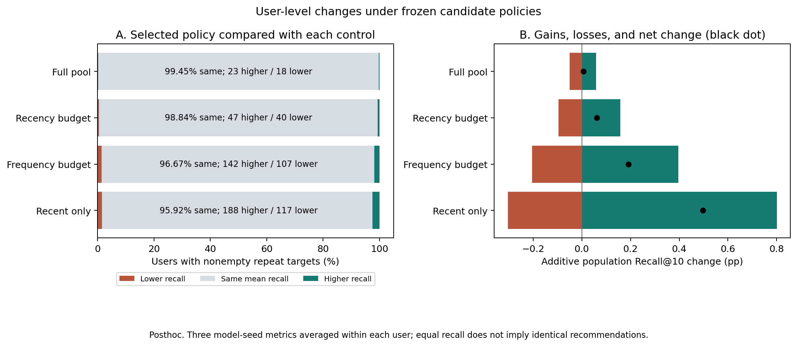
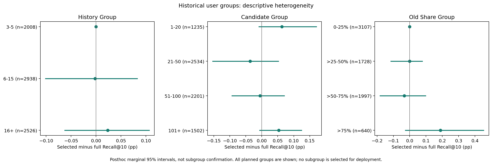
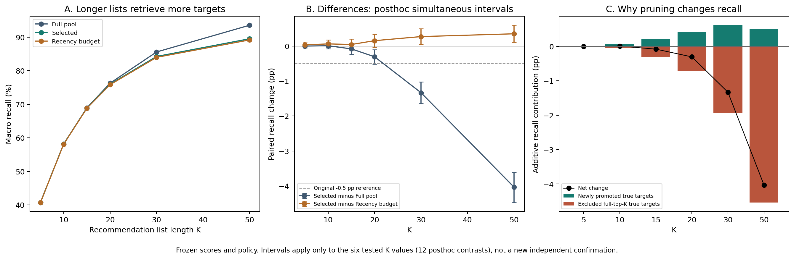
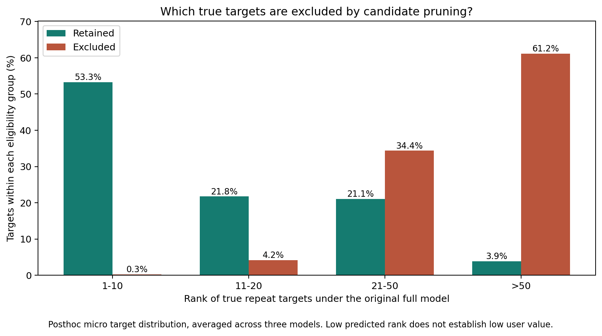

# 购物历史应该怎样使用：个体变化、简单对照与推荐长度

本报告接续[第四轮独立确认研究](../study4/research_story.md)，回答平均成绩背后还缺少的三个问题：哪些人的结果变了、同预算的近期选择为何接近双层候选、删去的真实目标在哪里。**这是看过确认结果后的事后分析，不是新一轮独立验证。** 模型、M=5、窗口5和用户均保持不变，没有再次选参或训练。

本轮进一步解释了原结果：**短清单的性能保留主要来自多数用户的推荐未改变，而非大范围收益与损失抵消；被删去的真实目标大多位于原模型排名尾部，随着推荐长度增加，这些目标逐渐进入完整候选方案的前K名，删候选的代价随之显现。** 同预算近期方案的接近表现也有结构原因：两方案都完整保留最近5单商品，只在少量旧商品的选择上不同。这里的“尾部”仅相对当前模型，不能解释为商品不重要。

所有结果沿用完整历史复购目标分母。共8,000名用户，7,472人目标非空；先对每位用户的三个模型指标取均值，再进行比较。这里的“改善/受损”仅指这次离线 Recall 的升降，不是用户满意度或实际购物收益。独立一致性审计：**PASS**。

## 1. 平均几乎不变，究竟是谁发生了变化？

| 选定策略减去 | 改善用户 | 召回相同 | 受损用户 | 总体平均差（百分点） | 正向贡献 | 负向贡献 |
| --- | --- | --- | --- | --- | --- | --- |
| 完整候选 | 0.31% | 99.45% | 0.24% | +0.007 | +0.058 | -0.051 |
| 同预算最近购买 | 0.63% | 98.84% | 0.54% | +0.061 | +0.157 | -0.096 |
| 同预算最高频 | 1.90% | 96.67% | 1.43% | +0.192 | +0.396 | -0.205 |
| 仅最近5单 | 2.52% | 95.92% | 1.57% | +0.497 | +0.801 | -0.304 |

相对完整候选，99.45% 的非空目标用户平均 Recall 相同，0.31% 提高，0.24% 降低。正负贡献都按全部7,472人作分母，二者相加才是总体变化；不能只展示改善者的条件平均。平均绝对变化为 +0.109 个百分点，净变化为 +0.007 个百分点。

具体是 **23 人改善、18 人受损、7431 人相同**。变化人数很少，但不能因此说每个人都无损：受损者的条件平均召回下降为 21.03 个百分点。这是按结果筛选的事后人群，不能当成预测前已知的风险群体，也不应把这种条件均值当成总体损失。

“召回相同”可能意味着清单相同，也可能是不同商品恰好命中相同数量。三个种子的指标平均还可能抵消方向，因此另存了逐种子结果与是否曾在任一种子变化的标记，不把平均为零当作每个模型都完全相同。

## 2. 同预算最近购买策略：相近表现是否来自相近的候选？

| 对照 | 全部用户 | 逐模型清单完全相同比例的均值 | 三个模型清单均完全相同 | Top10平均Jaccard |
| --- | --- | --- | --- | --- |
| 完整候选 | 8000 | 96.75% | 96.23% | 99.26% |
| 同预算最近购买 | 8000 | 95.24% | 94.61% | 98.83% |
| 同预算最高频 | 8000 | 91.94% | 91.21% | 97.81% |
| 仅最近5单 | 8000 | 84.40% | 83.25% | 95.70% |

以上使用全部8,000用户，清单是否相同无需用户有复购目标；只取7,472名非空目标用户的对应结果另存于表中。相对完整候选，96.23% 的用户在三个模型下都保持原清单。表中“逐模型均值”与“所有模型都相同”是不同统计量。固定同一分数与稳定排序时，两个清单集合相同则顺序也相同；有序与无序统计在本数据中一致。

同预算近期方案与选定方案的**整体候选平均Jaccard为 92.92%**，但仅比较两边出现过的旧商品，平均Jaccard降为 **53.35%**（只对旧商品并集非空的5,650人计算）。所有用户的近期商品都被两种方案共同保留；高整体重合率因此部分来自设计，而不是两种旧商品选择真的完全等价。三个模型都给出完全相同Top10的用户占 **94.61%**。

这为“简单近期对照为何接近”提供了当前固定排名下的解释：两方案的大部分候选相同，剩余差异又很少改变前10名。不能据此推出长期频次信息在所有推荐长度、模型或数据集上都没有价值。

候选 Jaccard 是交集除以并集；Top10 的有序/无序相同分别要求顺序也一致、或仅商品集合一致。清单相似度本身不是因果证明，但能判断我们究竟比较了多大程度上不同的选择。两个策略使用相同逐用户候选数量和同一评分，差别只在选哪些较早商品。候选差集的历史购买次数与距上次购买订单数见结果表，不能用未来目标来决定保留哪些商品。

## 3. 历史分组能否解释变化发生在哪里？

| 历史变量 | 分组 | 非空目标用户 | 平均差（百分点） | 边际95%区间 |
| --- | --- | --- | --- | --- |
| history_group | 3-5 | 2008 | +0.000 | [+0.000, +0.000] |
| history_group | 6-15 | 2938 | -0.002 | [-0.101, +0.083] |
| history_group | 16+ | 2526 | +0.023 | [-0.063, +0.107] |
| candidate_group | 1-20 | 1235 | +0.063 | [-0.009, +0.171] |
| candidate_group | 21-50 | 2534 | -0.036 | [-0.153, +0.052] |
| candidate_group | 51-100 | 2201 | -0.006 | [-0.093, +0.071] |
| candidate_group | 101+ | 1502 | +0.053 | [-0.006, +0.124] |
| old_share_group | 0-25% | 3107 | +0.000 | [+0.000, +0.000] |
| old_share_group | >25-50% | 1728 | +0.000 | [-0.116, +0.077] |
| old_share_group | >50-75% | 1997 | -0.034 | [-0.182, +0.098] |
| old_share_group | >75% | 640 | +0.189 | [-0.027, +0.453] |

分组在预测前可计算，但本轮分组分析是在结果已知后制定。所有预先列入本次分析计划的组都报告，区间为2,000次用户 bootstrap 的边际95%区间，没有对大量组间观察作确认性校正。不能据此选择一个“适用人群”，再把同一批用户称为该选择的独立验证。结果还受分组样本量与既有模型限制。高频/近期等候选选择原则的因果或部署收益需要另外的数据验证。

本次相对完整候选的各历史分组区间均包含零，或差异按构造恒为零，未提供稳定的分组获益证据。例如3–5单用户的全部历史本就在最近5单范围内，这一组没有发生候选删减，零差异不能包装成方法有效性的独立发现。旧商品比例高的组也不能仅凭较高点估计就被选为部署对象。

## 4. 推荐清单变长后，损失从哪里出现？

| K | 完整候选 Recall | 选定策略 Recall | 差异（百分点） | 事后同时95%区间 | 被删除真命中贡献 | 补位真命中贡献 |
| --- | --- | --- | --- | --- | --- | --- |
| 5 | 40.75% | 40.75% | -0.001 | [-0.057, +0.042] | -0.013 | +0.012 |
| 10 | 58.16% | 58.17% | +0.007 | [-0.078, +0.070] | -0.055 | +0.062 |
| 15 | 68.95% | 68.87% | -0.082 | [-0.241, +0.070] | -0.306 | +0.224 |
| 20 | 76.31% | 76.00% | -0.308 | [-0.517, -0.103] | -0.722 | +0.415 |
| 30 | 85.60% | 84.26% | -1.334 | [-1.645, -1.023] | -1.945 | +0.611 |
| 50 | 93.56% | 89.53% | -4.028 | [-4.471, -3.606] | -4.537 | +0.509 |

这里固定每个商品原先的完整模型分数，只删候选并让后面的保留商品补位。逐用户恒等式为：**选定方案命中数 − 完整方案命中数 = 新补位真命中 − 被删掉的完整TopK真命中**。两项分别除以同一个完整复购目标数，得到表中可相加的召回贡献。

本次检查 K=5/10/15/20/30/50；两个对照共12项差异使用6,000次用户 bootstrap，同时区间作 Bonferroni 调整，但仍属于事后证据。图中的−0.5个百分点只是原研究预定界限的参考线；不能把本次观察得到的某个K宣称为已独立验证的“安全上限”。K=20点估计下降不自动意味着未通过原界限，也不能用K=10结论保证任意长清单的效果。

实际区间进一步收窄了说法：K=20 的差异为 -0.308 个百分点，事后同时区间 [-0.517, -0.103]，略跨越−0.5的参考界限，不能在这套事后比较中保证损失小于0.5个百分点；这也不是重新判定原Top10确认实验失败。K=30、50 的差异扩大为 -1.334、-4.028 个百分点，区间更明确地显示长清单代价。

另一个有用的边界是：K=30、50 时，选定方案比同预算最近购买分别高 +0.269、+0.349 个百分点，其事后同时区间在零之上。这提示旧常购选择在更深的列表里可能更有用；但它同时落后完整候选，因此不能把这一局部对照收益包装成总体推荐改进，后续若要提出新策略仍需新数据验证。

## 5. 被排除的真目标并非不存在，它们通常排在哪里？

| 原完整模型排名 | 保留目标数（三种子均值） | 排除目标数（三种子均值） | 占排除目标比例 |
| --- | --- | --- | --- |
| 1-10 | 24406.0 | 13.7 | 0.26% |
| 11-20 | 9962.7 | 221.3 | 4.20% |
| 21-50 | 9652.7 | 1813.3 | 34.38% |
| >50 | 1780.7 | 3225.7 | 61.16% |

排名表是按真实目标商品汇总的 micro 描述，和用户平均 Recall 的口径不同。它衡量既有模型把目标排在哪里，不能推断低位商品不重要、需求消失、用户已经遗忘，或任何更好的模型也预测不了。候选删减制造的不可召回目标仍被计入分母。排名尾部的目标在短清单中原本很少被命中，长清单或更强模型则可能改变这笔取舍。

被排除的 **5,274 个真实复购目标**中，仅 **0.26%** 原先位于完整模型前10名，**95.54%** 位于20名以后（排名按三个模型汇总平均）。这解释了为何目标覆盖率已经下降，短清单召回却几乎不变；也解释了为何推荐变长后，原先隐藏在后排的删除代价开始出现。这里描述的是原固定模型中的命中去向，并非证明被删商品可以永久舍弃。

## 6. 更新后的主线与贡献定位

建议题目为 **《购物推荐应该记住什么？——历史信息、候选竞争与选择性保留》**。课堂讲述从长短历史用户的原始差距引入，再用第四轮的同用户、同目标对照区分评分信息与候选竞争；本报告补充个体得失、简单对照相似度与清单长度范围。

可保留的贡献是：固定评价对象的实验设计、旧商品找回与挤出的机制证据、候选精简的性能与覆盖取舍。不能把同预算近期策略的接近表现藏起来，也不能把事后分组或新的K曲线包装成新的方法胜利。45%左右候选总量下降仍不等于实测评分提速，完整历史特征和原始全量分数一直保留。

复现：`python -m study4_followup.run audit` 与 `python -m study4_followup.run report`。分析计划与输入时序见 [protocol.json](protocol.json)、[provenance.json](provenance.json)，精选结果在 [tables/users_change_summary.csv](tables/users_change_summary.csv) 与 [tables/depth_contrasts.csv](tables/depth_contrasts.csv)。原第四轮确认结论保留不变；这里新增的是解释和适用范围。
